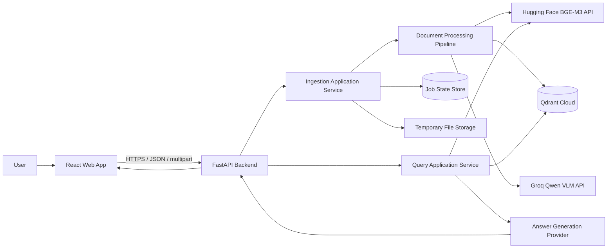
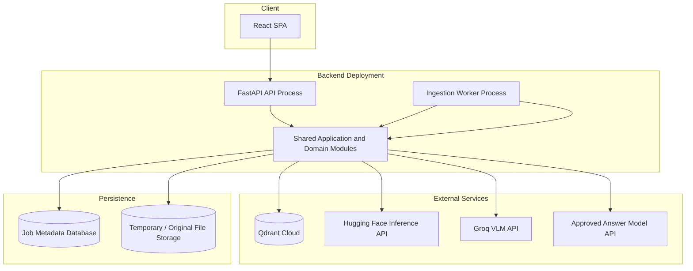
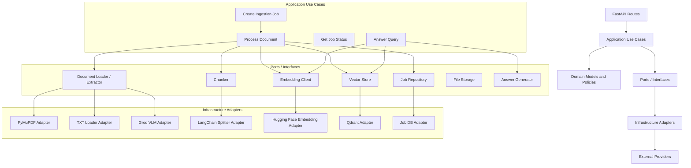
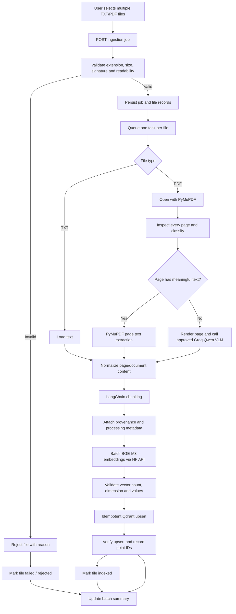
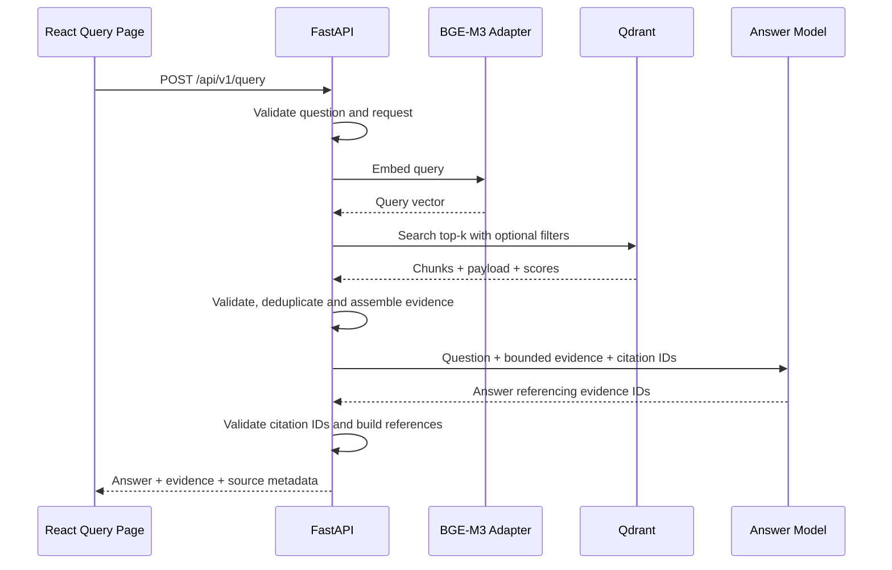

# System Architecture
## IIITBH-RAG — Modular Retrieval-Augmented Generation System

**Status:** Proposed architecture aligned with `PRD.md`  
**Architecture style:** Modular monolith, ports-and-adapters (hexagonal boundaries), asynchronous ingestion jobs  
**Backend:** FastAPI / Python  
**Frontend:** React  
**Vector store:** Qdrant Cloud  
**Embedding provider:** Hugging Face API — BGE-M3 (exact endpoint/model configuration to be confirmed)  
**Scanned-page extraction:** Qwen vision-language model through Groq (exact supported model ID to be confirmed)

---

## 1. Architecture objectives and principles

The architecture must deliver a reliable document-to-evidence pipeline without coupling business logic to a specific model provider, file loader, vector database, or UI.

Principles:

1. **Modular monolith first:** one deployable FastAPI backend with strict internal module boundaries. Do not introduce microservices, message brokers or distributed orchestration until scale or operational needs justify them.
2. **Ports and adapters:** business services depend on interfaces; provider-specific SDKs remain inside adapters.
3. **Separate ingestion and query paths:** ingestion is a long-running job workflow; querying is a short request/response workflow.
4. **Page-aware processing:** PDFs are classified and processed page by page so mixed PDFs do not lose content.
5. **Provenance is mandatory:** every chunk must be traceable to a document and page or text location.
6. **Evidence-first answers:** generation receives retrieved evidence and must cite it; unsupported answers must be declined.
7. **Idempotent ingestion:** retries and re-uploads must not silently create duplicate vector points.
8. **Explicit configuration:** model IDs, chunking settings, thresholds, Qdrant collection settings and upload limits are configuration, not hidden constants.
9. **Observable stages:** every file and page has a visible processing state and diagnostic outcome.
10. **No silent assumptions:** unresolved provider/model/API decisions remain configuration gates until verified.

## 2. High-level system context



**Trust boundaries**
- The browser is untrusted. Validate all incoming files and request fields on the backend.
- Provider credentials and Qdrant credentials exist only in backend configuration.
- Uploaded documents and extracted text are untrusted data, not instructions. Never follow instructions found inside documents.
- Retrieved content is evidence supplied to the answer model; it must not override system/developer instructions or authorize tools/actions.

## 3. Deployment shape

### Initial deployment

Use a single backend deployment with independent modules and a background worker process. The worker may initially run from the same codebase and deployment unit, but it should be a separate process from the FastAPI request-serving process so large PDF extraction and embedding jobs do not block API requests.



The exact job database and file storage product are not specified by the PRD. For local development, a simple durable local implementation may be used behind interfaces. Before production deployment, choose durable shared storage and a persistent job store appropriate to the deployment. Do not store job state only in process memory if jobs must survive restarts.

### Why not microservices initially?

The workload is separable by module but the expected first release does not establish independent scaling or team ownership requirements. A modular monolith reduces deployment and debugging overhead while preserving the option to extract worker or provider adapters later.

## 4. Backend component architecture



### Layer responsibilities

| Layer | Responsibility | Must not contain |
|---|---|---|
| API / presentation | HTTP validation, auth boundary, response schemas | PDF parsing, prompt logic, Qdrant SDK calls |
| Application | Orchestrates use cases and transactions | Provider-specific SDK details |
| Domain | Document/job states, classification policy, provenance rules | FastAPI or external SDK dependencies |
| Ports | Contracts for extraction, chunking, embedding, storage, generation | Provider implementations |
| Infrastructure | PyMuPDF, LangChain, Groq, HF, Qdrant, persistence adapters | UI concerns |
| Worker | Executes queued ingestion jobs and records outcomes | HTTP request lifecycle assumptions |

## 5. Recommended repository structure

Keep the existing `PRD.md` and this `ARCHITECTURE.md` at the project root.

```text
PROJECT- IIITBH-RAG/
├── PRD.md
├── ARCHITECTURE.md
├── README.md
├── .gitignore
├── .env.example
├── backend/
│   ├── pyproject.toml
│   ├── alembic.ini
│   ├── migrations/
│   ├── app/
│   │   ├── main.py
│   │   ├── api/
│   │   │   ├── dependencies.py
│   │   │   ├── error_handlers.py
│   │   │   └── v1/
│   │   │       ├── router.py
│   │   │       └── endpoints/
│   │   │           ├── ingestion.py
│   │   │           ├── jobs.py
│   │   │           ├── query.py
│   │   │           └── health.py
│   │   ├── core/
│   │   │   ├── config.py
│   │   │   ├── logging.py
│   │   │   ├── security.py
│   │   │   └── telemetry.py
│   │   ├── domain/
│   │   │   ├── documents/
│   │   │   │   ├── models.py
│   │   │   │   ├── enums.py
│   │   │   │   └── policies.py
│   │   │   ├── ingestion/
│   │   │   │   ├── models.py
│   │   │   │   └── states.py
│   │   │   └── retrieval/
│   │   │       └── models.py
│   │   ├── application/
│   │   │   ├── ingestion/
│   │   │   │   ├── create_job.py
│   │   │   │   ├── process_document.py
│   │   │   │   └── get_job_status.py
│   │   │   └── query/
│   │   │       └── answer_question.py
│   │   ├── ports/
│   │   │   ├── document_extractor.py
│   │   │   ├── chunker.py
│   │   │   ├── embedding_client.py
│   │   │   ├── vector_store.py
│   │   │   ├── job_repository.py
│   │   │   ├── file_storage.py
│   │   │   └── answer_generator.py
│   │   ├── infrastructure/
│   │   │   ├── extraction/
│   │   │   │   ├── txt_loader.py
│   │   │   │   ├── pymupdf_classifier.py
│   │   │   │   ├── digital_pdf_extractor.py
│   │   │   │   └── groq_qwen_vlm_extractor.py
│   │   │   ├── chunking/
│   │   │   │   └── langchain_chunker.py
│   │   │   ├── embeddings/
│   │   │   │   └── huggingface_bge_m3.py
│   │   │   ├── vectorstores/
│   │   │   │   └── qdrant_store.py
│   │   │   ├── generation/
│   │   │   │   └── answer_model.py
│   │   │   ├── persistence/
│   │   │   │   └── job_repository.py
│   │   │   └── storage/
│   │   │       └── local_file_storage.py
│   │   ├── workers/
│   │   │   ├── runner.py
│   │   │   └── tasks.py
│   │   └── observability/
│   │       └── events.py
│   └── tests/
│       ├── unit/
│       ├── integration/
│       └── fixtures/
├── frontend/
│   ├── package.json
│   └── src/
│       ├── app/
│       ├── pages/
│       │   ├── IngestionPage/
│       │   └── QueryPage/
│       ├── components/
│       │   ├── layout/
│       │   ├── ingestion/
│       │   ├── query/
│       │   └── evidence/
│       ├── services/
│       │   └── api/
│       ├── hooks/
│       ├── types/
│       └── styles/
├── docs/
│   ├── decisions/
│   ├── api-contracts/
│   └── runbooks/
└── scripts/
    ├── check_environment.py
    └── inspect_qdrant_collection.py
```

This is a target structure. Create modules as they are needed; do not generate empty folders and boilerplate for every item in advance.

## 6. Ingestion pipeline — detailed flow



### 6.1 File and page routing

- TXT: one logical text source, with line/section metadata where practical.
- PDF: create a page manifest first. Each page receives a classification decision and metrics.
- Digital PDF page: use PyMuPDF text extraction.
- Image-only page: render with PyMuPDF and send the image to the configured VLM.
- Mixed PDF: combine page outputs in original page order. Do not route the entire PDF to only one extraction method.
- Empty page: record it as empty; do not fabricate text.
- Extraction failure: record page-level failure and allow policy-controlled retry or partial document status.

### 6.2 PDF classification policy

Classification is a routing heuristic, not a definitive statement about how a PDF was authored.

A recommended initial policy:
- Evaluate each page independently using extracted character count and, if useful, text-block count.
- Threshold values must be configurable and calibrated against the existing institute corpus.
- Mark a page text-bearing when it meets the configured meaningful-text threshold.
- Mark a page image-only when no meaningful text is extractable.
- Document-level status is DIGITAL when all meaningful pages are text-bearing, SCANNED when no pages are text-bearing, and MIXED when both categories occur.
- Do not classify a page as scanned merely because it contains an image; digital PDFs can contain diagrams, logos and photographs alongside selectable text.
- Preserve the metrics and rule version so classification can be audited.

### 6.3 Extraction result contract

Each extracted page/document segment should produce a normalized object equivalent to:

```json
{
  "document_id": "stable-document-id",
  "source_file": "example.pdf",
  "file_type": "pdf",
  "pdf_classification": "MIXED",
  "page_number": 4,
  "extraction_method": "pymupdf | groq_qwen_vlm | txt_loader",
  "text": "Extracted page text...",
  "extraction_status": "success | partial | empty | failed",
  "warnings": [],
  "metadata": {
    "extractor_version": "configured-version",
    "model_id": null,
    "prompt_version": null
  }
}
```

For VLM-extracted pages, set model and prompt metadata. For digital pages, record the PyMuPDF version. Never store a fabricated source URL; it is optional metadata only when genuinely known.

## 7. Chunking and provenance architecture

Chunking occurs after extraction and normalization. The chunker must accept normalized document/page objects and return chunks with provenance intact.

Recommended behaviour:
- Split long page text using a configurable LangChain recursive character or token-aware splitter, selected after corpus tests.
- Preserve page number and source document ID on every chunk.
- Do not allow overlap to cross a PDF page boundary by default. If a future strategy combines pages, preserve the full list/range of page references.
- Keep small pages intact where possible.
- Treat tables specially: preserve row/column relationships in the text representation; avoid arbitrary row splitting.
- Record chunker name, size, overlap and configuration version.
- Do not set numeric chunk size or overlap as a product truth until measured on representative documents.

### Chunk metadata contract

```json
{
  "chunk_id": "deterministic-or-stable-unique-id",
  "document_id": "stable-document-id",
  "ingestion_job_id": "job-id",
  "source_file": "academic_calendar.pdf",
  "file_type": "pdf",
  "pdf_classification": "DIGITAL",
  "page_number": 2,
  "chunk_index": 3,
  "text": "Chunk text...",
  "extraction_method": "pymupdf",
  "document_category": "academic_calendar",
  "embedding_model": "confirmed-bge-m3-model-id",
  "chunker": "confirmed-langchain-splitter",
  "chunk_size": null,
  "chunk_overlap": null,
  "created_at": "ISO-8601 timestamp"
}
```

Fields such as category, URL, publication date and academic year should be included only when known or explicitly supplied. Do not infer document dates from filenames without validation.

## 8. Embedding and Qdrant design

### Embedding adapter

The embedding adapter should expose operations such as:
- `embed_documents(texts)`
- `embed_query(text)`
- `model_info()`

It must:
- use the same confirmed model/configuration for documents and queries;
- batch inputs within provider limits;
- preserve input/output ordering;
- validate number of returned vectors and vector dimensions;
- reject NaN, infinite or malformed vector values;
- apply bounded retry/backoff for transient failures;
- report provider request IDs where available without logging secrets.

**Critical:** Confirm the exact Hugging Face API mode and model repository ID, and inspect the actual output dimension before collection creation. Do not assume vector size from an old Qdrant collection configuration.

### Qdrant point design

Use one point per chunk. Store the vector plus payload containing chunk text and provenance metadata.

- Point ID: stable deterministic UUID derived from document identity/version and chunk identity, or another documented idempotent strategy.
- Collection: configured name; do not hardcode it in business logic.
- Distance metric: choose based on the confirmed embedding model recommendation and validate experimentally.
- Payload indexes: add indexes for frequently filtered fields only, such as document ID, source file, category and file type.
- Re-ingestion: use a document version/hash strategy. Replacing a document must delete or supersede its previous points safely; the policy must be explicitly selected.
- Store collection configuration and embedding model identity so incompatible vectors are not mixed.

### Safe indexing sequence

1. Extract and chunk the complete file.
2. Generate and validate all embeddings for that file (or persist a recoverable page/chunk checkpoint).
3. Upsert points with stable IDs.
4. Verify expected point IDs/count.
5. Mark the file indexed.
6. On failure, retain a recoverable failed state and do not report full success.

For large files, use bounded batches and checkpoints. Decide whether a document is visible to retrieval only after all required chunks are successfully indexed, using a document status/filter or staging strategy.

## 9. Query and evidence pipeline



### Query rules

1. Embed the question using the same BGE-M3 model as ingestion.
2. Search Qdrant with configured top-k and optional metadata filters.
3. Apply a configured score threshold only after validating score semantics for the selected metric.
4. Deduplicate near-identical chunks and preserve useful page diversity.
5. Assemble bounded evidence snippets with stable evidence IDs.
6. Call Groq's OpenAI-compatible Chat Completions endpoint with `openai/gpt-oss-120b` for answer generation (separate from the Qwen VLM used during scanned-page extraction).
7. Require the model to cite evidence IDs for factual statements.
8. Validate that every returned evidence ID exists in the retrieved set.
9. Map evidence IDs to source file/page/excerpt in the API response.
10. If evidence is empty, weak, contradictory or does not answer the question, return an insufficient-evidence response.

Do not trust citations generated as free-form filenames or page numbers by the model. The backend owns the citation map and validates every citation against retrieved chunks.

### Suggested query response

```json
{
  "query_id": "query-id",
  "answer": "The academic calendar states ... [1]",
  "status": "answered",
  "insufficient_evidence": false,
  "sources": [
    {
      "evidence_id": "E1",
      "source_file": "2026-27 Academic Calendar.pdf",
      "page_number": 1,
      "chunk_id": "point-id",
      "excerpt": "Relevant source excerpt...",
      "score": 0.82
    }
  ],
  "retrieval": {
    "collection": "configured-collection",
    "embedding_model": "confirmed-model-id"
  }
}
```

The example is illustrative only. Do not hardcode example scores, model names, collection names or source content.

## 10. API boundaries

Initial versioned endpoints:

| Method | Endpoint | Purpose |
|---|---|---|
| POST | `/api/v1/ingestion/jobs` | Multipart multi-file upload and job creation |
| GET | `/api/v1/ingestion/jobs/{job_id}` | Batch and per-file progress |
| GET | `/api/v1/ingestion/jobs/{job_id}/results` | Final processing summary |
| POST | `/api/v1/query` | Evidence-grounded question answering |
| GET | `/api/v1/health` | Backend health |
| GET | `/api/v1/health/dependencies` | Dependency readiness, without revealing credentials |

Use typed request/response schemas. Upload endpoints should return a job ID quickly; clients poll the job endpoint or use a later-approved event mechanism. Do not keep an HTTP request open for the entire VLM/embedding workflow.

## 11. Job state model and failure handling

### Batch states

- `queued`
- `processing`
- `completed`
- `completed_with_errors`
- `failed`
- `cancelled` (only if cancellation is implemented)

### Per-file states

- `received`
- `validating`
- `classifying`
- `extracting`
- `chunking`
- `embedding`
- `indexing`
- `completed`
- `completed_with_warnings`
- `failed`
- `rejected`

Persist timestamps, attempt count, current stage, page counts, chunk count, Qdrant point IDs or verifiable count, warnings and structured error code/message. Avoid exposing stack traces to the frontend.

Retry policy:
- Retry transient network errors, provider rate limits and temporary service failures with bounded exponential backoff and jitter.
- Do not retry malformed PDFs, unsupported file types, invalid credentials or invalid model IDs without configuration changes.
- Page-level VLM errors should be visible and retryable independently where practical.
- A partially extracted or indexed file must never be labelled fully completed.

## 12. Frontend architecture

Only two primary navigation destinations are required.

### Ingestion page

Components:
- `MultiFileDropzone`
- `SelectedFileList`
- `PdfClassificationBadge`
- `IngestionJobProgress`
- `FileProcessingStatus`
- `IngestionResultSummary`
- `ProcessingErrorList`

Expected states:
- no files selected;
- files selected and ready;
- submitting;
- queued/processing;
- completed;
- completed with warnings;
- failed.

### Query page

Components:
- `ChatTranscript`
- `QuestionComposer`
- `AnswerMessage`
- `CitationList`
- `EvidenceDrawer`
- `QueryLoadingState`
- `InsufficientEvidenceNotice`

The frontend should only call the FastAPI API. It must never call Groq, Hugging Face or Qdrant directly. Use a central typed API client, environment-based backend URL, and explicit error/loading states.

## 13. Security and data handling

- Keep all provider keys and Qdrant credentials on the backend.
- Never place secrets in Vite/React environment variables exposed to the browser.
- Validate extension, MIME type, file signature where practical, file size, page count and parser result.
- Generate server-side filenames; do not trust uploaded path names.
- Store temporary files outside public static directories.
- Apply cleanup and retention policy to temporary uploads and rendered page images.
- Treat document text and VLM output as untrusted content.
- Protect the answer-generation prompt against prompt injection embedded in source documents.
- Restrict CORS and configure upload limits/timeouts.
- Avoid logging full document contents, user secrets or API tokens.
- Decide authentication and authorization requirements before exposing the service beyond a trusted local environment.

## 14. Observability

Every processing event should carry:
- `request_id`
- `ingestion_job_id`
- `document_id`
- `page_number` when applicable
- `stage`
- `provider` and model ID when applicable
- `duration_ms`
- `status`
- structured error code on failure

Useful metrics:
- uploaded files and batch completion rate;
- PDF classification counts;
- pages extracted by PyMuPDF versus VLM;
- VLM/API latency and failure rate;
- chunk counts and average chunk size;
- embedding latency and failures;
- Qdrant upsert latency and verification failures;
- query latency, retrieval result count and no-evidence rate.

Do not log API keys or full sensitive content.

## 15. Testing architecture

### Unit tests
- PDF page classification thresholds and DIGITAL/SCANNED/MIXED aggregation.
- TXT and PDF routing.
- Mixed-PDF page ordering and extraction method selection.
- Chunk metadata and page provenance.
- Stable document/chunk IDs and duplicate policy.
- Embedding response dimension/count validation.
- Citation ID validation and insufficient-evidence policy.

### Integration tests
- PyMuPDF digital PDF extraction.
- Groq VLM adapter with mocked provider responses and a separately controlled live smoke test.
- Hugging Face embedding adapter with mocked responses and live smoke test.
- Qdrant upsert, retrieval, payload filtering and deletion/version policy.

### End-to-end corpus
Use representative fixtures:
1. TXT with known content.
2. Digital PDF.
3. Scanned PDF.
4. Mixed PDF.
5. PDF containing tables.

For each fixture, compare extraction against known expected content, check page provenance, ingest into a test collection, query a known fact, and verify that the returned citation points to the correct source page.

## 16. Configuration and unresolved decisions

The following values must be external configuration and confirmed before implementation:

| Decision | Required confirmation |
|---|---|
| Groq VLM | Exact Qwen model ID supporting image input; “Qwen 3.8” is not treated as a verified model ID |
| Answer generation | Selected: Groq-hosted OpenAI GPT-OSS 120B (`openai/gpt-oss-120b`) |
| Hugging Face | Exact BGE-M3 model ID, API mode/endpoint, auth and vector dimension |
| Qdrant | Cloud URL, collection name, distance metric and verified vector size |
| Chunking | Splitter, chunk size and overlap based on corpus evaluation |
| Retrieval | Top-k, score threshold, filtering and optional reranker |
| Job persistence | Database or durable store for job and file states |
| File storage | Temporary/original upload storage and retention |
| Limits | Maximum files per batch, per-file size and PDF page count |
| Duplicate policy | Skip, replace/version, or create a separate document version |
| Authentication | Local single-user or authenticated deployment |
| Citation source | Uploaded document only, source URL when available, or both |
| Deployment | Local development target and intended production host |

Configuration names should be centralised in typed settings. Provide placeholders in `.env.example`; never commit actual secrets.

## 17. Architecture decision records (ADRs)

Create a short ADR under `docs/decisions/` whenever a material design decision is finalised. At minimum, record:

- ADR-001: modular monolith and worker execution model;
- ADR-002: job persistence and background execution mechanism;
- ADR-003: exact Groq VLM model and image request strategy;
- ADR-004: Hugging Face BGE-M3 API mode and vector dimensions;
- ADR-005: Qdrant collection schema and distance metric;
- ADR-006: chunking strategy and measured parameters;
- ADR-007: answer-generation model and citation validation;
- ADR-008: duplicate/re-ingestion and document version policy.

Each ADR should include context, decision, alternatives considered and consequences. Do not mark a decision accepted until it is verified.

## 18. Implementation sequence

1. **Foundation:** backend skeleton, settings, logging, typed schemas, health checks and test setup.
2. **Contracts:** define normalized document/page/chunk models and provider ports.
3. **Local extraction:** TXT loader, PyMuPDF classifier, digital PDF extraction and fixtures.
4. **VLM adapter:** verify Groq model ID and image API, then implement scanned-page extraction.
5. **Chunking:** LangChain splitter and provenance tests.
6. **Embedding:** verify HF BGE-M3 API output and dimension; implement adapter.
7. **Vector storage:** configure Qdrant test collection, upsert and retrieval.
8. **Ingestion jobs:** durable job state, worker execution, progress and partial failure handling.
9. **Query:** retrieval, approved answer model, evidence assembly and backend citation validation.
10. **React UI:** Ingestion page and Query page against stable API contracts.
11. **End-to-end validation:** run representative corpus and measure extraction, retrieval and citation quality.
12. **Production hardening:** authentication, storage retention, limits, monitoring, backups and deployment runbook.

## 19. Definition of architecture compliance

An implementation follows this architecture when:
- provider SDKs are isolated behind adapters;
- FastAPI routes contain no extraction, embedding or vector-store business logic;
- ingestion runs as tracked background jobs;
- PDFs are handled page by page and mixed PDFs use both extraction routes as needed;
- all chunks preserve source/page provenance;
- document and query embeddings use the same confirmed BGE-M3 configuration;
- Qdrant points are idempotent and verifiable;
- final answer citations are resolved and validated by the backend;
- insufficient evidence is handled explicitly;
- secrets never reach the browser;
- tests cover the complete TXT, digital PDF, scanned PDF, mixed PDF and query paths.

---

**Relationship to PRD:** This document defines the system structure and component responsibilities for the requirements in `PRD.md`. The answer-generation choice is recorded in ADR-007 (Groq-hosted GPT-OSS 120B); its live provider contract remains to be verified. Other unresolved provider and product decisions must be confirmed and recorded in ADRs before production use.
